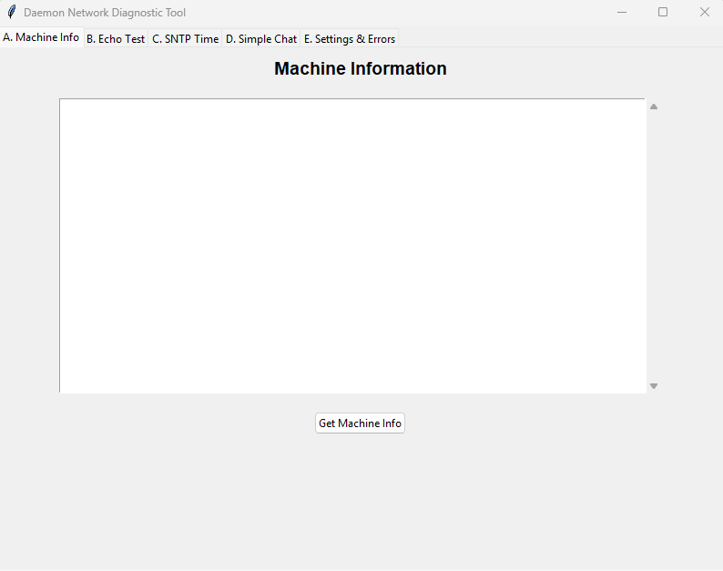
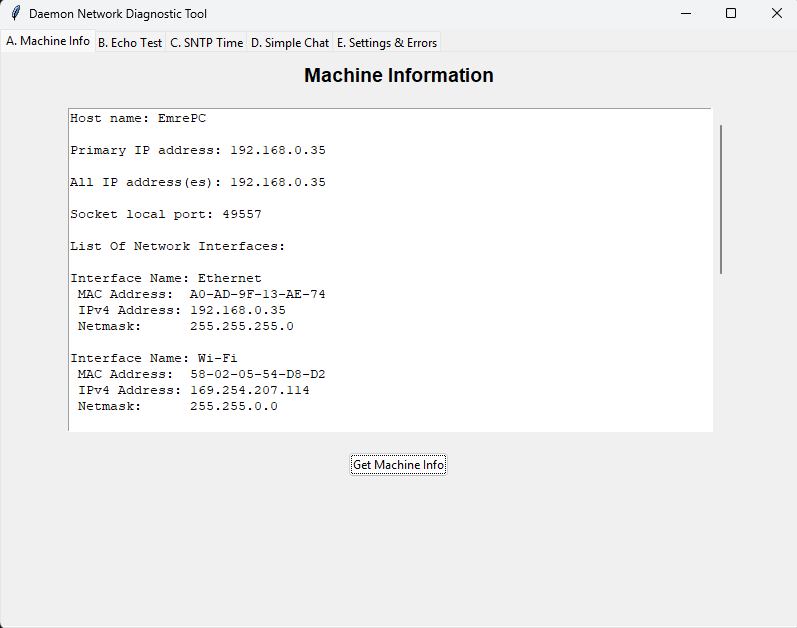
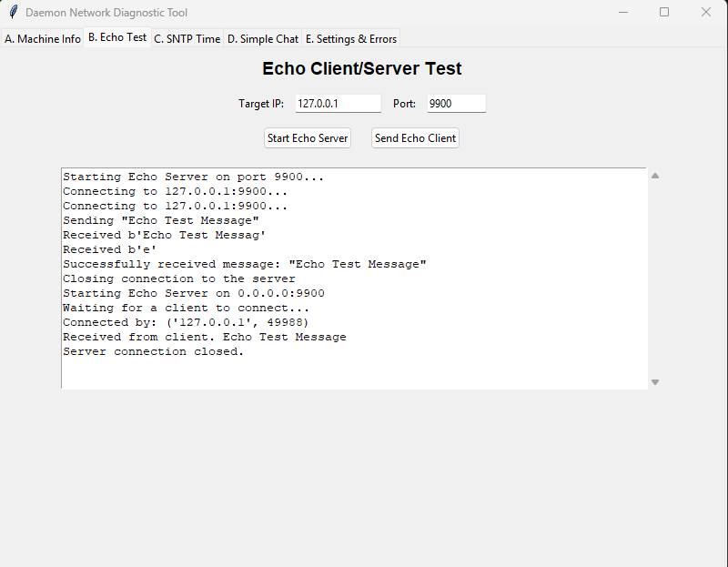
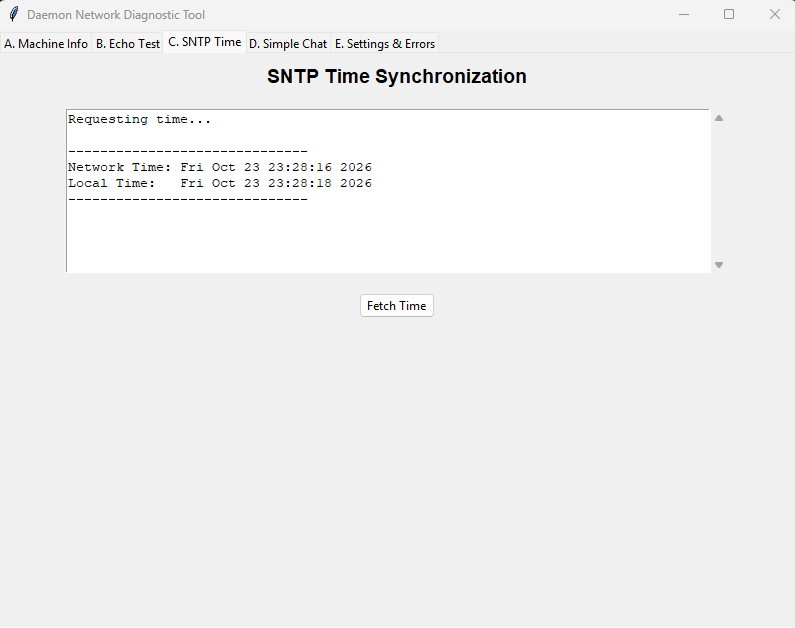
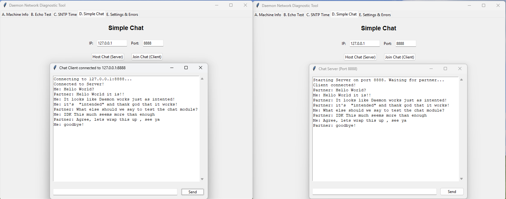
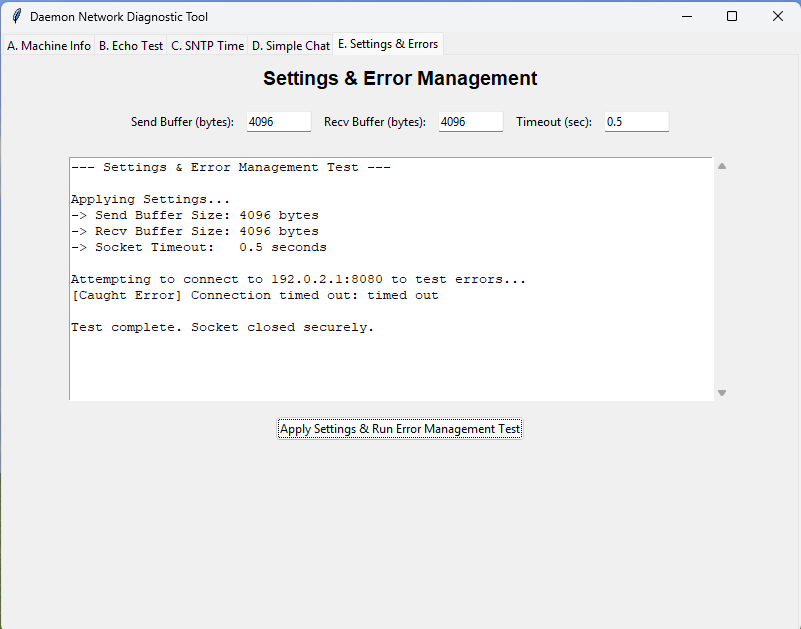

# Daemon Network Diagnostic and Tool Package
Daemon is a comprehensive network diagnostic tool


**Author:** Emre Kahraman  
**Student ID:** 2022555035 
**Course:** CEN322 – Network Programming  
**Instructor:** Sedat BİLGİLİ
**Submission Date:** October 23, 2026  

---

## Table of Contents
1. [Project Overview](#project-overview)
2. [Architectural Design](#architectural-design)
3. [Module Breakdown](#module-breakdown)
4. [Prerequisites & Installation](#prerequisites--installation)
5. [Execution & Usage Guide](#execution--usage-guide)
6. [Test Outputs](#test-outputs)

---

## Project Overview
The **Daemon Network Diagnostic Tool** is a comprehensive, cross-platform Python application designed to execute fundamental network operations, diagnostics, and troubleshooting. 

Going beyond standard command-line scripts, this project integrates a fully functional, tabbed Graphical User Interface (GUI) built with `tkinter`. It fulfills all requirements by successfully demonstrating socket programming, TCP client/server bridging, SNTP time synchronization, raw socket configurations, and error management.

## Architectural Design
In strict adherence to the **"Modular Approach"** requirement of the project rubric, the interface and backend logic are completely decoupled. 

* **The Frontend (`main.py`):** Acts purely as a visual wrapper and thread manager. It gathers user inputs, triggers backend functions, and safely maps returned data to the screen. 
* **The Backend (Modules A-E):** Written as independent `.py` files. They contain pure network and OS logic. They return formatted data strings rather than relying on terminal prints, allowing them to be utilized by the GUI or independently via the terminal.

---

## Module Breakdown

### Module A: Machine Information (`machine_info.py`)
Extracts comprehensive local machine data.
* **Mechanism:** Uses `socket.gethostname()` for the system name. Pings Google DNS (`8.8.8.8`) via a dummy UDP socket to extract the primary outbound IP. Uses `psutil.net_if_addrs()` to iterate through all hardware network interfaces, extracting their corresponding IPv4 addresses, subnet masks, and MAC addresses.

### Module B: Echo Test (`echo_test.py`)
Provides basic connection testing via a TCP echo client/server architecture.
* **Mechanism:** The server binds to `0.0.0.0` with `SO_REUSEADDR` enabled, listening for incoming TCP streams. The client connects to the designated port, sends a string, and waits for an exact byte-for-byte reflection. Evaluates success via string matching.

### Module C: SNTP Time Synchronization (`sntp_time.py`)
Retrieves the current network time and compares it against local hardware time.
* **Mechanism:** Utilizes the `ntplib` library to send an SNTP version 3 request to `pool.ntp.org`. Parses the `tx_time` from the response, formats it via `time.ctime()`, and returns it alongside the local system time.

### Module D: Simple Chat (`simple_chat.py`)
A bi-directional, threaded chat room supporting multiple concurrent pop-up windows.
* **Mechanism:** Employs `tk.Toplevel()` to spawn dedicated server/client windows so users can test connections on the same screen. Uses `threading.Thread` to constantly listen for incoming `sock.recv()` data without freezing the main Tkinter loop. 
* **Logging:** Chat histories are automatically written to unique, timestamped log files (e.g., `chat_log_YYYY-MM-DD_HH-MM-SS.txt`) upon window creation to prevent OS file-lock crashes.

### Module E: Settings & Error Management (`settings_errors.py`)
Demonstrates raw socket manipulation and intentional exception catching.
* **Mechanism:** Accepts `SO_SNDBUF` (Send Buffer), `SO_RCVBUF` (Receive Buffer), and timeout parameters from the user. Applies them using `socket.setsockopt()` and `socket.settimeout()`. 
* **Error Testing:** Intentionally attempts to connect to `192.0.2.1` (TEST-NET-1, a reserved unreachable IP). Depending on the timeout provided, it successfully catches and reports `socket.timeout`, `socket.gaierror`, or `socket.error` exceptions.

---

## Prerequisites & Installation

**Development Environment:** Python 3.x (Tested on Windows)

### 1. Standard Libraries Used (Built-in)
* `socket`, `threading`, `tkinter`, `time`, `datetime`

### 2. Third-Party Libraries Required
To run this application, you must install the following Python packages:
```bash
pip install psutil ntplib

```markdown
### 2. Third-Party Libraries Required
To run this application, you must install the following Python packages:
```bash
pip install psutil ntplib
```

---

## Execution & Usage Guide

### 1. Initial Setup
1. Extract the project zip file to your local machine.
2. Open your terminal (or Command Prompt / PowerShell) and navigate into the extracted project directory.
3. Ensure the required third-party libraries are installed by running:
   ```bash
   pip install psutil ntplib
   ```

### 2. Running the Application
Start the graphical interface by executing the main Python file from the terminal:
```bash
python main.py
```
The main dashboard window will open, displaying five distinct tabs corresponding to the project modules.

### 3. Module-by-Module Testing Instructions

**Tab A: Machine Info (Module A)**
* **Action:** Click the "Get Machine Info" button.
* **Expected Output:** The text area will instantly populate with your device's hostname, primary outbound IP, and a detailed list of all network interfaces (including IPv4, Subnet, and MAC addresses).

**Tab B: Echo Test (Module B)**
* **To Test Locally:** 
  1. On the Echo tab, leave the Port as `9900` and click **"Start Echo Server"**. 
  2. Open a *second* terminal window, navigate to the folder, and run `python main.py` again to open a second app instance.
  3. In the second instance, go to the Echo tab, ensure Target IP is `127.0.0.1` and Port is `9900`, then click **"Send Echo (Client)"**.
* **Expected Output:** The server logs will confirm a connection, and the client logs will display the exact bytes sent and successfully reflected back.

**Tab C: SNTP Sync (Module C)**
* **Action:** Ensure you have an active internet connection and click "Fetch Network Time".
* **Expected Output:** The application queries `pool.ntp.org` and displays the fetched Network Time alongside your Local System Time for immediate comparison.

**Tab D: Simple Chat (Module D)**
* **Action:** 
  1. Click **"Host Chat (Server)"**. A dedicated pop-up window will appear waiting for a connection.
  2. In the main window, click **"Join Chat (Client)"**. A second pop-up window will appear and connect to the server.
  3. Type messages in the bottom entry bar of either window and press `Enter`.
* **Expected Output:** Messages will route synchronously between windows. Once the chat is finished, check the project root folder to view the uniquely timestamped `.txt` files containing your automatically saved chat logs.

**Tab E: Settings & Errors (Module E)**
* **Action:** 
  1. Leave the Send/Recv buffers at `4096`.
  2. Set the Timeout to `0.5` (for a standard timeout) or `0.0` (to forcibly demonstrate Non-Blocking Mode).
  3. Click **"Apply Settings & Run Error Management Test"**.
* **Expected Output:** The system will apply the settings, log the confirmation, and intentionally attempt a connection to `192.0.2.1` (an unreachable IP). A successfully caught network exception (e.g., `[Caught Error] Connection timed out`) will be printed, proving the error management blocks function correctly.

---

## Test Outputs

Below are the screenshots demonstrating the successful execution of the main interface and each individual backend module. 

### Main Interface (`main.py`)


### Module A: Machine Information (`machine_info.py`)


### Module B: Echo Test (`echo_test.py`)


### Module C: SNTP Time Synchronization (`sntp_time.py`)


### Module D: Simple Chat (`simple_chat.py`)

*(Note: Automated chat logs (`.txt`) are also included in the `test_outputs` folder.)*

### Module E: Settings & Errors (`settings_errors.py`)


---